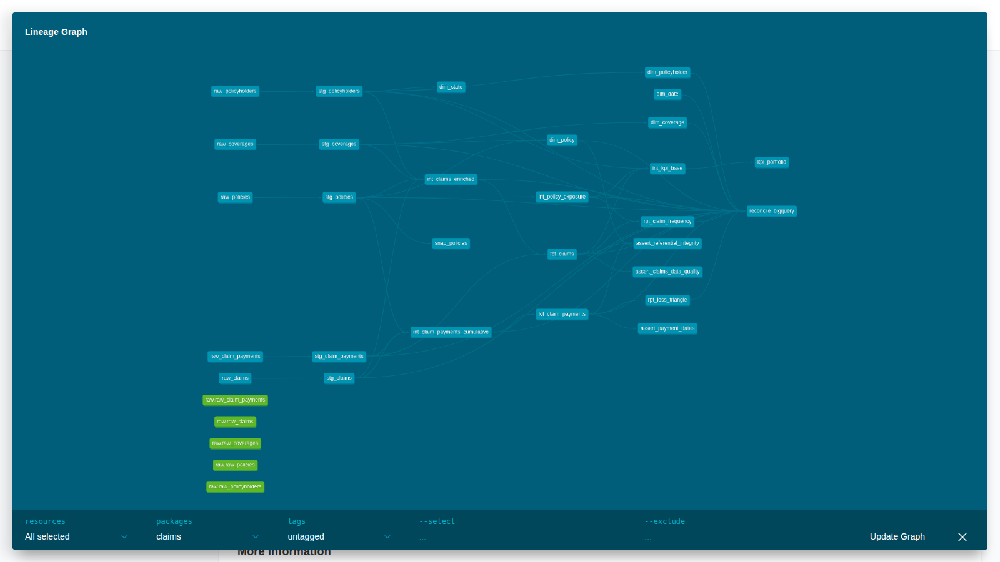

# dbt_claims

A dbt port of the Dataform warehouse in `projects/01-claims-warehouse`. Same models, same names, same business logic, but it runs locally on DuckDB by default and can target Snowflake. The data is the synthetic claims sample from `projects/01-claims-warehouse/data/sample_data/`, copied here as seeds.



Model docs and the lineage graph (built by CI from `main`): https://gonorandres.github.io/data-engineer-path/ (open the graph icon, bottom right, for the full lineage).

In the graph, the green nodes at the bottom left are the `raw` sources. They exist only for freshness checks, so nothing depends on them; staging reads the seeds (`raw_*`, top left) instead. `reconcile_bigquery` is an analysis (a saved query), not a table.

## Run it locally

```bash
pip install -r requirements.txt
dbt build --profiles-dir .
dbt docs generate --profiles-dir . && dbt docs serve --profiles-dir .
```

Run these from `dbt_claims/`. `dbt build` loads the seeds, takes the policy snapshot, builds every model and runs every test, in dependency order, starting from an empty database. The DuckDB file `claims.duckdb` is created in this directory and is gitignored.

Terms used below:

- **Seed**: a CSV file in `seeds/` that dbt loads as a table. Column types are declared in `seeds/_seeds.yml` so DuckDB and Snowflake type them the same way.
- **Source freshness**: a check that compares the newest date in a source table to today and warns if it is too old.
- **Snapshot / SCD2**: a table that keeps history. When a tracked column changes, the old row is closed (`dbt_valid_to` is filled in) and a new row is added (slowly changing dimension, type 2).
- **adapter.dispatch**: dbt's way to write one macro with a separate implementation per database (`duckdb__name`, `snowflake__name`, and a `default__name` fallback).

## Layers

| Layer | Folder | Models | Purpose |
|---|---|---|---|
| Raw | `seeds/` | `raw_claims`, `raw_policies`, `raw_policyholders`, `raw_coverages`, `raw_claim_payments` | CSVs as loaded |
| Staging | `models/staging` | `stg_claims`, `stg_claim_payments`, `stg_coverages`, `stg_policies`, `stg_policyholders` | Cast, trim, lower-case, derive simple fields |
| Intermediate | `models/intermediate` | `int_claims_enriched`, `int_claim_payments_cumulative`, `int_policy_exposure`, `int_kpi_base` | Joins, running totals, exposure and earned premium |
| Marts | `models/marts` | `fct_claims`, `fct_claim_payments`, `dim_policy`, `dim_policyholder`, `dim_coverage`, `dim_state`, `dim_date` | Star schema |
| Reports | `models/reports` | `rpt_loss_triangle`, `rpt_claim_frequency` | Actuarial reports, as in Dataform |
| KPIs | `models/kpis` | `kpi_portfolio` | Portfolio KPIs at four grains |

`int_kpi_base`, `dim_state`, `kpi_portfolio` and `snap_policies` have no Dataform counterpart. Everything else keeps its Dataform name. Two small differences in existing models: `int_claims_enriched` and `fct_claims` gain a `state_code` column (needed to link claims to `dim_state`), and `dim_date` weekday and month names are built with `case` expressions so they are the same on both engines. In the report models, the correlated subquery in `rpt_loss_triangle` became a join to a claim-count CTE; the result is the same.

Staging reads the seeds with `ref()`, not `source()`. A `source()` call creates no dependency on the seed, so `dbt build` on an empty database could try to read tables before they are loaded. `models/sources.yml` declares the same tables as source `raw` only so `dbt source freshness` has something to check.

## Star schema mapping

The star schema has dimensions for policy, insured, line of business, state and date. This is how each maps onto what the data actually contains:

| Concept | Dimension | Key used by the facts | Notes |
|---|---|---|---|
| Policy | `dim_policy` | `policy_id` | |
| Insured | `dim_policyholder` | `policyholder_id` | The policyholder is the insured. Name kept from Dataform. |
| Line of business | `dim_coverage` | `coverage_type` | auto, health, home, liability, life |
| State | `dim_state` | `state_code` | 32 distinct codes from `policyholders.state_code`. The data has no state names, so there is only the code. |
| Date | `dim_date` | `date_key` (YYYYMMDD) | 2019-01-01 to 2026-12-31 |

`fct_claims` (one row per claim) and `fct_claim_payments` (one row per payment) join to these on the natural keys above. The relationship tests in `models/marts/_marts.yml` check each link.

## KPI definitions

Each formula is written once, in `macros/kpis.sql`, and used by both `rpt_claim_frequency` and `kpi_portfolio`. They are the definitions Dataform's `rpt_claim_frequency` already used.

| KPI | Formula |
|---|---|
| Claim frequency | `claim_count / exposure_years` |
| Severity | `total_paid / claim_count` |
| Pure premium | `total_incurred / exposure_years` |
| Loss ratio | `total_incurred / earned_premium` |

- `total_incurred` is paid plus current case reserve (`incurred_amount` in `fct_claims`). `total_paid` includes recoveries, which are negative.
- Exposure and earned premium come from `int_policy_exposure`: the policy period is clipped to 2020-01-01 through the valuation date (2025-12-31, set in `dbt_project.yml` vars), exposure years are days / 365.25, and earned premium is annual premium pro-rated by exposure days over policy term days. Cancelled policies are excluded. All of a policy's exposure is assigned to the year its exposure starts, as in Dataform.
- A zero or missing denominator gives null.

`kpi_portfolio` has a `grain` column: `overall`, `coverage_type`, `accident_year` or `state_code`. Dimension columns that are not part of the grain are null.

## Tests

- `unique` and `not_null` on every primary key.
- `relationships` from the facts to `dim_policy`, `dim_policyholder`, `dim_coverage`, `dim_state` and `dim_date`, and from `fct_claim_payments` to `fct_claims`.
- `accepted_values` for `coverage_type`, `state_code`, `claim_status`, `payment_type`, policy `status` and the KPI `grain`, using the values actually present in the CSVs.
- Custom generic tests in `tests/generic/`: `non_negative` (indemnity and expense totals; payment amounts, excluding recoveries, which are negative by design) and `development_year_non_negative` (payments and the cumulative payments model).
- The three Dataform assertions as singular tests in `tests/`: `assert_claims_data_quality`, `assert_payment_dates`, `assert_referential_integrity`.
- Source freshness (`dbt source freshness`, separate from `dbt build`): warn only, no error threshold. The data is a static extract, so it warns by design.

## Snapshot

`snapshots/snap_policies.sql` is an SCD2 snapshot of `stg_policies` with `unique_key: policy_id` and the `check` strategy on `status`, `annual_premium`, `coverage_limit`, `deductible` and `expiration_date`. With the static seed data it holds exactly one version per policy (800 rows, all current) until the source changes. To see it work, edit a value in `seeds/raw_policies.csv`, run `dbt seed` and `dbt snapshot`, and the changed policy will have a closed row and a new current row.

## Cross-engine SQL

Models avoid engine-specific functions. dbt's built-in macros cover date differences, safe casts and the date spine. What dbt does not cover is in `macros/cross_engine.sql`: money and 64-bit float types (`dbt.type_float()` is a 32-bit float on DuckDB, so it is not used), the valuation date, date keys, and ISO week and day of week, the last two with `adapter.dispatch` implementations for DuckDB and Snowflake.

## Snowflake

Export the connection values, then pass the target:

```bash
pip install -r requirements-snowflake.txt
export SNOWFLAKE_ACCOUNT=... SNOWFLAKE_USER=... SNOWFLAKE_PASSWORD=... \
       SNOWFLAKE_ROLE=... SNOWFLAKE_WAREHOUSE=... SNOWFLAKE_DATABASE=...
# optional: SNOWFLAKE_SCHEMA (defaults to CLAIMS)
dbt build --profiles-dir . --target snowflake
```

**This has not been run against a real Snowflake account.** The only check done is `dbt parse --target snowflake` with dummy values, which succeeds without connecting. Commands that compile or run need a live connection and were not exercised. Expect to fix small things on a first real run.

## Reconciling with BigQuery

`analyses/reconcile_bigquery.sql` returns row counts per model and sums of the main money columns, with the equivalent BigQuery queries in a comment at the bottom. Compare floating-point sums (`earned_premium`, `exposure_years`) after rounding to two decimals.

## Linting

```bash
sqlfluff lint models snapshots tests macros analyses
```

Configuration is in `.sqlfluff` (dbt templater, DuckDB dialect, lower-case keywords). The excluded rules and the reasons are written in that file.

## Orchestration

`../airflow/dags/claims_dbt.py` runs `dbt seed`, `dbt snapshot`, `dbt run` and `dbt test` as an Airflow DAG. See its docstring.
