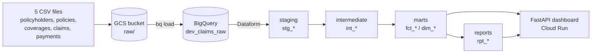

# The Claims Pipeline, Explained End to End

What happens to a claim record from the moment it exists as a CSV row until it
shows up as a number on https://data-engineer.gonor.me, why each step exists,
and which parts actually run today versus which are there to show an
alternative. Read this first; the project READMEs go deeper on each piece.

## 1. The business question

An insurer has to answer three questions over and over:

| Question | Who asks | Number that answers it |
|---|---|---|
| Are we charging enough for each line of business? | Pricing actuaries | **Pure premium** (expected loss per unit of exposure) and **loss ratio** (losses / earned premium) |
| How much will we still pay on claims that already happened? | Reserving actuaries, finance | **Loss development triangle**: how paid amounts for each accident year grow as the years pass |
| Where and in what is risk concentrated? | Underwriting, management | **Frequency** (claims per exposure year) and **severity** (average cost per claim) by state, coverage, year |

None of these can be read off the raw operational data. A claims system
stores one row per claim and one row per payment; a policy system stores
policies and the people who hold them. The pipeline's job is to turn those
operational tables into tables shaped for these questions, the same way every
time, with checks that stop wrong numbers before anyone sees them.

**The data here is synthetic.** 500 policyholders, 800 policies, 608 claims
and 2,654 payments, generated by `projects/01-claims-warehouse/src/data_generator.py`.
It behaves like insurance data (claims are reported after the accident,
payments arrive over years, reserves fall as claims are paid) but the
premiums are not calibrated: the overall loss ratio comes out near 199%,
which in a real book would mean the insurer is losing money badly. Treat the
numbers as a demonstration of the mechanics, not as findings.

## 2. The flow, one stage at a time

| Stage | What happens | Why it is a separate step |
|---|---|---|
| **Files in GCS** | The five CSVs sit in `gs://dev-claims-data-<project>/raw/`. | Object storage is the cheap, durable copy. If every table is lost, this is what you rebuild from -- which is exactly what happened on 2026-11-21. |
| **Raw layer** (`dev_claims_raw`) | `bq load` copies each file into a table, unchanged. | Loading and transforming are kept apart. Dataform is only allowed to *read* raw tables, so a bug in a transform can never damage the source. |
| **Staging** (`stg_*`) | One table per source: types cast, text trimmed and lower-cased, obvious derived fields added. | Every later model can trust that dates are dates and `'Auto '` is `auto`. Cleaning happens in exactly one place. |
| **Intermediate** (`int_*`) | Joins and calculations: claims enriched with policy and policyholder, running totals of payments, exposure and earned premium per policy-year. | This is where business rules live (how exposure is clipped, what "earned" means), separated from both cleaning and presentation. |
| **Marts** (`fct_*`, `dim_*`) | A star schema: `fct_claims` (one row per claim) and `fct_claim_payments` (one row per payment), surrounded by dimensions for policy, policyholder (the insured), coverage (line of business) and date. | A star schema is the shape BI tools and analysts query fastest and most safely: facts hold the numbers, dimensions hold the descriptions you filter and group by. |
| **Reports** (`rpt_*`) | `rpt_loss_triangle` (cumulative paid by accident year x development year) and `rpt_claim_frequency` (frequency, severity, incurred by coverage and year). | These are the actuarial outputs themselves, precomputed so the dashboard does a cheap read instead of a heavy query. |
| **Dashboard** | FastAPI on Cloud Run queries the marts and reports, caches results for 5 minutes, and renders five pages. | The presentation layer owns no logic. If a number is wrong, the fix is in the warehouse, not the app. |

Along the way, 16 Dataform assertions (and 88 dbt tests in the dbt version)
check things that must always hold: every claim belongs to a policy that
exists, no payment is dated before its accident, keys are unique, paid
amounts are not negative except recoveries. If one fails, the build stops and
the previous tables stay in place.

## 3. Three engines, one set of models

The same transformation logic exists three times. That sounds wasteful, so
here is what each copy is for:

| Copy | Engine | Who triggers it | What reads the output | Status today |
|---|---|---|---|---|
| `projects/01-claims-warehouse/dataform/` | **Dataform on BigQuery** | Manually: `python scripts/deploy_dataform.py --project <id>` | The live dashboard | **This is production.** Last run 2026-11-21. |
| `projects/01-claims-warehouse/sql/` run by P02 | **DuckDB**, orchestrated by Dagster locally or Cloud Run + Cloud Scheduler in GCP | Dagster UI, or the `dev-claims-pipeline-daily` scheduler job (06:00 UTC) | Nothing downstream; it proves the pipeline runs and reports per-layer results | Scheduler job is **paused**. The Cloud Run service is deployed (internal). |
| `dbt_claims/` | **dbt on DuckDB**, Snowflake-ready | GitHub Actions on every PR and push to `main`; Airflow DAG `claims_dbt`; or `dbt build` by hand | The dbt docs site (models, tests, lineage) | Runs in CI on every change. Never run on Snowflake. |

Why keep them:

- **Dataform** is what you pick when the warehouse is BigQuery: nothing to
  host, no credentials to manage, and it is free.
- **dbt** is what most companies outside GCP use, and what job postings ask
  for. It runs on any warehouse through an adapter, so the same models can
  move from DuckDB (free, a single local file) to Snowflake by changing the
  profile. Having both shows the trade-off concretely instead of in the
  abstract; see the "Dataform over dbt" note on the Methodology page.
- **The DuckDB SQL in P02** exists to show orchestration (Dagster assets,
  Cloud Run jobs) with zero warehouse cost.

The three are kept honest by reconciliation: on 2026-11-21 the dbt build on
DuckDB and the Dataform build on BigQuery agreed on every row count and
money total checked (608 claims, 26,944,733.19 paid, 1,382,732.19 open
reserve, 738 policy-year exposure rows, 14,208,574.50 earned premium).

## 4. What the dbt version adds

dbt has the same layers and names as Dataform, plus four things:

- **`dim_state`.** Policyholders carry a state code; claims inherit it so
  risk can be grouped by state through a proper dimension.
- **`snap_policies`, a snapshot (SCD Type 2).** Policies change: a premium
  is raised, a policy is cancelled. A plain table only knows the current
  value. A snapshot keeps every version with `dbt_valid_from` / `dbt_valid_to`,
  so you can answer "what was this policy's premium on the day of the
  accident?". With static sample data it holds one version per policy; edit a
  row in `seeds/raw_policies.csv` and re-run to see a second version appear.
- **`kpi_portfolio`, the KPI layer.** Frequency, severity, pure premium and
  loss ratio are each written once, as macros in `macros/kpis.sql`, and
  reused by every report. Without this, the same ratio ends up defined
  slightly differently in three places and the numbers stop agreeing.
- **Cross-engine macros.** Where DuckDB and Snowflake disagree (date
  arithmetic, numeric types, week numbers), the difference lives in one macro
  with a version per engine (`adapter.dispatch`), so models stay identical.

## 5. Orchestration: who runs what, when

An orchestrator decides the order of steps, runs them, retries failures and
records what happened. This platform shows three, deliberately:

| Orchestrator | Where | Runs | Why it is here |
|---|---|---|---|
| **Cloud Scheduler + Cloud Run** | GCP | P02 pipeline, cron `0 6 * * *` (paused) | The cheap production choice for a single daily job: about $0.10/month versus ~$300+/month idle for Cloud Composer (managed Airflow). |
| **Dagster** | Local | P02 pipeline as software-defined assets, one per layer | Best local developer experience: you see each table as an asset with its own status and lineage. |
| **Airflow** | Local (DAG file in `airflow/dags/claims_dbt.py`) | `dbt seed` -> `dbt snapshot` -> `dbt run` -> `dbt test` | Airflow is the industry standard and what most teams already run. The DAG is the open-source equivalent of the Dagster setup. It uses four BashOperator tasks; Astronomer Cosmos could expand it to one task per dbt model once the project grows. |

The order inside the Airflow DAG matters: seeds first (load raw data),
snapshot second (record policy history against the freshly loaded data), run
third (build models), test last (stop if anything is wrong). `dbt build` does
the same in one command, interleaving tests right after each model.

## 6. CI/CD: what protects the live site

Every change goes through GitHub Actions before it can reach anyone:

1. **Lint and test** (`ci-cd.yml`) on every PR: ruff for Python, pytest for
   every project and the dashboard.
2. **dbt** (`dbt.yml`) on every PR: sqlfluff lints the SQL, `dbt build` on a
   fresh DuckDB runs all 113 steps and fails on any test failure, and the
   Airflow DAG is imported to prove it parses.
3. **Canary deploy** (on `main`, when the dashboard changed): the new revision
   is deployed with no traffic, smoke-tested on its own URL -- including a
   check that the overview shows real data, not an error -- and only then
   promoted. If the smoke test fails, the old revision keeps serving.
4. **Docs publish** (on `main`): dbt docs go to
   https://gonorandres.github.io/data-engineer-path/.
5. **Daily health check** (`health-check.yml`): checks the public site serves
   data, opens a GitHub issue when it does not, and closes it when it
   recovers.

## 7. The 2026 outage, as a worked example

On 2026-09-13 the dashboard started showing
`404 Not found: Table dev_claims_analytics.fct_claims`. Walking the flow
above explains it:

- The **app** was fine; it was faithfully reporting that its input was gone.
- The **marts, staging and raw tables** were all gone. GCS still had the files.
- Cause: Terraform had set a **30-day default table expiration** on the
  `dev_` datasets "to avoid cost". BigQuery stamps that expiry on each table
  when it is created, so the 2026-08-14 rebuild was scheduled for deletion on
  2026-09-13 -- and nothing rebuilt it, because the daily job runs DuckDB,
  not Dataform. The whole warehouse is ~300 KiB, so the expiry saved nothing.
- Fix: expiry turned off (and made opt-in in Terraform), raw layer reloaded
  from GCS, Dataform re-run. The dashboard now shows a "Data refreshing" card
  instead of the raw error if a table is ever missing again, while the health
  check still treats that card as a failure.

The lesson generalizes: a pipeline is only as reliable as the least visible
setting in it, and a monitor that checks "the page returns 200" would have
said everything was fine the whole time.

## 8. Known gaps

- **Nothing rebuilds BigQuery on a schedule.** The Dataform run is manual. A
  real setup would trigger it daily (a Dataform workflow configuration, or the
  P02 Cloud Run job calling the Dataform API).
- **The data never changes**, so source freshness always warns and the
  snapshot holds one version per row. Both are wired correctly and will
  behave properly the day the source changes.
- **Snowflake is untested.** The profile parses; no build has run against a
  real account.

## Related

- [[platform-reference-architecture]] -- the full six-project platform
- [[cost-effective-orchestration]] -- why Cloud Run + Scheduler over Composer
- [[dataform-guide]] -- Dataform specifics
- [[duckdb-local-dev]] -- DuckDB for local development
- [[ci-cd-for-data]] -- CI/CD patterns for data
